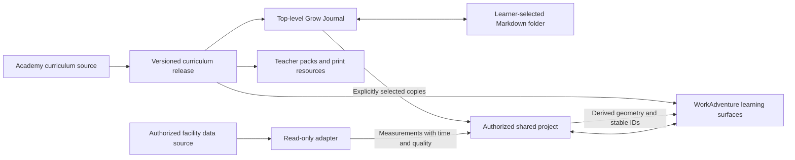

# Grownetics Academy journal and shared-world design

Date: 2026-09-28.

Status: the user has approved the design direction, including the combined learner experience. This written specification awaits the user's review before implementation planning. It does not authorize a production deployment, a domain migration, or connection to real equipment.

Decision authority: [CUR-005 through CUR-016](../../curriculum-decisions.md#approved-decisions). Supporting records: [learner experience](../../academy-learning-experience.md), [shared-world research](../../academy-game-world-concept.md), and [curriculum module map](../../curriculum-module-map.md).

## 1. Purpose and scope

Extend the existing Academy with a private learning journal, RPG-inspired progression, shared classrooms, and a collaborative CEA facility designer. Keep the conventional Academy available in its current repository and presentation. Learners, teachers, independent growers, and professional facility teams must be able to use the parts appropriate to their work.

The journal targets desktop Chrome and stores ordinary Markdown files and attachments in a folder chosen by the learner. The shared world extends WorkAdventure as a free Academy add-on. Guided learning and detailed facility planning use one dimensioned model, initially edited in 2D with heights, elevations, and growing levels.

The initial learning experience includes the Academy default, an original magical-botanical theme, an academic theme, and appearance/accessibility settings. Every module delivered through the new experience needs teaching materials, including a complete teacher PDF, presentations, student printables, and relevant curated video links.

A connected greenhouse view is a separately implemented, read-only capability. Simulation and predictive modeling require their own scientific models and validation. The current scope excludes a live AI tutor, real-equipment control, a native wrapper, and a full 3D editor. These exclusions do not remove authored Grownetics guidance, vertical geometry, the collaborative builder, or the requested twin investigation.

## 2. Architecture and ownership

| Component | Responsibility | Boundary |
| --- | --- | --- |
| Existing Academy repository | Canonical curriculum, conventional teaching site, references, teacher resources, versioned content releases | Does not host private journals or a multiplayer server |
| Separate Grow Journal repository | Static browser application, learning navigation, private Markdown editing, photo capture, progress, preferences | No learner account or game server required for private journal use |
| Learner-authorized folder | Durable entries, attachments, progress, and preferences | Browser indexes are disposable; the operator does not maintain a journal database |
| WorkAdventure extension | Shared campus, presence, communication, project entry points, and world-map presentation | Game state is not authoritative facility geometry or a telemetry database |
| Facility model and project service | Dimensioned projects, membership checks, shared changes, revisions, equipment relationships, exports | Does not inherit editing authority from avatar position, theme, or interface mode |
| Read-only operational adapter | Authorized source data, point mapping, provenance, timestamps, and quality | No actuator-command path or production credentials exposed to learners |

GitHub Pages is a candidate for static surfaces; its hosting policy and the final public origins must be checked before deployment. A custom domain is independent of the hosting platform. No change to `academy.grownetics.com` is authorized here. WorkAdventure and shared project services require server infrastructure, durable storage, backups, and maintenance.

Keep file access at a small browser-specific boundary. Learning logic must not depend on native-wrapper APIs or a speculative runtime AI adapter.

### Cross-component data flow



Open the filesystem-authorized journal in its own top-level browser context. Do not assume a cross-origin WorkAdventure iframe can request directory access. The facility editor may use an embedded application surface because it does not inherit private-folder authority.

Navigation between surfaces may carry curriculum IDs or project references. Each service must still authorize access. URLs and world messages must not carry private journal text, local file paths, or filesystem handles.

## 3. Curriculum and release contract

Retain one authoritative authoring source. The Academy, journal, shared-world activities, and teacher resources consume identified releases rather than separately authored copies of a lesson.

A release must expose these semantics, regardless of its eventual serialization:

- Stable module ID, title, curriculum version, and publication status.
- Learning outcomes and explicit prerequisite relationships.
- Activity routes, their equipment and supervision requirements, and the outcomes each route can establish.
- Lesson content, scientific and safety guidance, evidence criteria, glossary, and contextual explanations.
- Teacher-pack, presentation, worksheet, and print-resource references.
- Citations and media records with creator, source, applicable license, and modification information.

The release must distinguish published lessons from drafts and planning briefs. Importing the module map cannot turn its proposed modules into published courses. Preserve the existing Academy's publication states and URLs. Materials admitted to the new experience must meet its resource requirements; missing teacher packs cannot be silently labeled complete.

A journal progress record identifies the module and curriculum version used. Updating curriculum must not silently reinterpret old work against new criteria. Show missing or unavailable content explicitly; never substitute a different cached lesson under the requested version.

Local-first refers to ownership and saving of learner records. An already loaded journal must not need the class server or an internet round trip to save local work. Initial application loads, uncached lessons, and external resources can require connectivity. Offline reload support is not promised by the local-folder architecture; deployment documentation must state the actual supported behavior. A network failure must not delete saved files or replace an unavailable lesson with unrelated content.

## 4. Private journal and file lifecycle

The portable folder layout is:

```text
Grow Journal/
  entries/       Markdown entries
  media/         Copied photographs and other attachments
  progress.md    Module, version, activity-route, and evidence records
  preferences.md Appearance and accessibility preferences
```

Use stable entry/media identifiers and relative attachment references. Preserve readable Markdown bodies and explicit metadata versions. Dates, measured quantities, units, specimen context, and the distinction between observations and interpretations must remain understandable outside the app. Folder relocation must not require the original machine's absolute paths.

### Create, open, and reconnect

1. Explain what the application will read and write, then ask the learner to create or select a dedicated journal folder. A suggested Documents location grants no access by itself.
2. Check existing journal structure before writing. Choosing an unrelated folder must not authorize replacing existing files with the application's preferred filenames.
3. Reuse a remembered folder handle only when browser permission allows it. Otherwise request reconnection through a user action.
4. Treat browser indexes and remembered handles as conveniences. Clearing browser storage must leave saved journal files intact.
5. If folder access is unsupported or disabled by managed-device policy, explain the limitation. Do not display a browser-only draft as a durable local save or promise equivalent direct-folder support on Safari, Firefox, or iPads.

### Save states and failures

Use distinct pending, saving, saved, failed, disconnected, and external-change states. Autosave after a short typing pause; show saved only when the entry and its referenced pending attachments have completed their writes. A partial attachment failure leaves the entry unsaved or incompletely saved, with a visible explanation.

On a write or permission failure, keep pending work in the open editor. Offer reconnecting and a recovery download containing unsaved text and pending attachments with usable relative links. An in-memory draft is not guaranteed to survive closing or crashing the tab.

If an external modification is detected, pause autosaving the affected file and let the learner keep both versions or resolve the difference. Do not silently overwrite the detected change. The browser does not provide a general safe-concurrent-editing guarantee across arbitrary external programs; document that limit without claiming an atomic cross-application transaction.

Unrecognized metadata or unsupported versions must not be silently discarded by rewriting a file. Open such content without destructive migration and explain what the app can safely do. Treat imported Markdown as content, not executable code; private entries must not run scripts or automatically fetch embedded remote resources.

Local storage is not a backup or application-level encryption. Explain whole-folder backup and transfer. Cloud-folder synchronization and access by other people using the same operating-system or browser profile are outside the private-journal boundary; school deployment must address shared-device procedures explicitly.

## 5. Capture and scientific observation

Provide both Take photo and Add existing photo. Request camera access only after the learner chooses capture, request video without microphone audio, and stop camera tracks when leaving the capture flow. A denied permission or missing camera must leave image import and appropriate non-photo observation routes usable.

The capture flow is choose purpose, frame, capture, review, keep or retake, then describe the observation. Teach:

- Context views that show the growing setup, whole-plant views that retain relevant structures, and detail views of a particular feature.
- Even, diffuse light; avoiding backlighting, glare, and obscuring shadows; steady framing and focus on the relevant subject.
- A simple background when practical and a ruler in the subject's plane when size matters.
- Comparable specimen, viewpoint, distance, lighting, and scale for time-series observations. Record unavoidable changes.
- A short caption explaining what another reader should notice, with specimen identity and observation time.

The approximately 85% close-up framing example is a teaching heuristic, not a universal threshold or a machine-scored rule. Retain relevant edges and scale information. Do not recommend filters that change evidentiary color or appearance.

Import time must not be mislabeled as capture time. Let the learner confirm when an imported observation occurred. Store the retained image locally and keep its caption/context with the entry. No upload, image diagnosis, AI scoring, or automatic mastery judgment is part of this flow.

Drawing, text, or measurements may satisfy an outcome when photography is unnecessary or inaccessible. A photo requirement must follow the learning outcome, not camera ownership.

## 6. Progression and RPG learning

The learning loop is to explore a question, choose an appropriate activity, observe or build, record evidence, explain its limitations, and review the work. The class world provides hubs, team projects, and cooperative objectives; the journal provides the learner's evidence record and field guide.

Use the existing module map and prerequisites. Discover, Measure, Control, Integrate, and Investigate describe increasing system scope, not five compulsory courses. Interest pathways can intersect. Learners may explore and read lessons without earning access, and demonstrate equivalent prior competence where appropriate. Readiness does not grant permission for unsupervised equipment use.

The foundation pathway illustrates the contract:

| Module | Evidence | Prerequisite |
| --- | --- | --- |
| FND-01, Plants as Living Systems | Dated observations with a causal claim kept distinct from what was observed | None |
| FND-02, Asking Testable Questions | Comparison plan, prediction, measurable outcome, and potential confounder | FND-01 |
| FND-03, Measurements, Units & Uncertainty | Repeated readings with dates, units, resolution, and justified uncertainty | None |
| FND-04, From Records to Evidence | Graph or accessible ordered table and a claim supported by records, with limitations | FND-02 and FND-03 |

A displayed pathway order must not invent prerequisites; FND-03 remains independently accessible. These examples do not select a classroom pilot or publish the draft modules.

Private progress states are not started, exploring, practicing, and self-reviewed completion. Each record identifies the activity route, relevant evidence, and curriculum version. Supplied-data analysis cannot be reported as hands-on sensor, wiring, calibration, or camera competence.

Use visible milestones and optional botanical flourishes. Do not reward repeated clicks, excessive uploads, or daily attendance with punitive streaks. An attachment or checkbox does not prove mastery. Self-edited local records are not authenticated credentials. Teacher assessment must identify the reviewer and submitted evidence/version separately from self-review.

Learners can revisit activities and revise explanations when new evidence contradicts an earlier claim. Preserve which version and evidence a prior review concerned.

## 7. Themes, accessibility, and guidance

| Appearance | Required treatment |
| --- | --- |
| Academy default | Continuity with the existing field-guide style, including its light/dark direction, Lora, DM Sans, IBM Plex Mono, and green/paper/terracotta palette |
| Magical botanical | Original scholarly fieldbook composition, warm paper, scientifically reviewed botanical illustrations and labels, restrained margin growth, and optional gentle reveals |
| Academic | Quiet, information-dense reading with direct list/table/diagram access and print-friendly structure |

Themes change presentation. They must not change curriculum claims, evidence criteria, object identity, dimensions, revisions, permissions, or world collisions. Learning/design mode is also separate from appearance and authorization.

Allow text size, spacing, reading width, contrast-safe appearance choices, and motion preferences. Keep these controls available independently of rewards. Honor reduced motion and provide immediate text display. Support keyboard navigation, visible focus, readable contrast, text status labels, meaningful image descriptions, and responsive reading order. Do not require hover or avatar navigation to reach essential learning tasks.

Botanical teaching images require appropriate scientific and rights review. Label species, growth stage, and source where relevant. Historical plates are references, not photographs of the learner's plant. Pixel-world sprites and decorative ornament must not be presented as identification keys. Use original or properly licensed artwork; no copied franchise assets are authorized.

Grownetics guidance is an intelligent, scientific, casual, approachable editorial voice. Put short prompts beside the relevant action and offer deeper explanations and sources on request. Explain technical vocabulary when it becomes useful. Separate observation, inference, and uncertainty; never imply that an authored guide has inspected a learner's plant, wiring, or competence.

Editorial workflow: draft against outcomes and sources, review science and safety, apply Humanizer and complementary clear-writing guidance, recheck claims and citations after tone edits, then review readability and accessibility before publication. Authoring tools do not require a runtime model or access to learner files.

## 8. Teacher resources and publishing

Every released module in the new experience must include a complete teacher PDF and the following resources:

- Lesson plan with outcomes, prerequisites, preparation, materials, timing, safety, facilitation, and likely misconceptions.
- Teaching presentation with figures, explanation notes, and source credits.
- Relevant curated YouTube or other video links, with their teaching purpose and an accessible text-based route to the required learning. An unavailable external video must not strand the core activity.
- Student lesson, activity instructions, printable observation/measurement worksheets, reflection prompts, glossary, and evidence checklist.
- Assessment rubric, teacher answer notes, and example evidence with its limitations.
- Accessible alternatives and an explicit account of which practical outcomes each alternative does or does not establish.
- Module/release identity, revision information, citations, media rights, and any actually established standards mappings.

Generate accessible HTML, complete teacher PDFs, presentations, and student printables from the canonical curriculum source and identified assets. Editable resources must retain applicable rights and notices. Keep print low-ink and legible, with useful page breaks, captions, readable tables, and no dependence on animation or color alone. Check actual generated documents, including their reading order, rather than assuming browser layout proves accessible PDF output.

Teachers must be able to use the resources without WorkAdventure or access to private journal folders. Draft materials must remain visibly draft. Do not claim classroom validation, standards alignment, accreditation, or partner endorsement from the existence of a resource pack.

Link to external resources first. Copy, adapt, embed, or bundle a particular work only when its license and terms permit the intended use. Attribution does not create permission, and a free download does not settle noncommercial-use restrictions. Avoid automatic third-party embeds in private journal surfaces. Preserve citations in exported and printed materials.

## 9. Shared classroom and project collaboration

Provide a shared class campus, separate collaborative team facilities, protected teaching templates, and an optional whole-class demonstration project. Independent growers and professional teams use the same project system without needing a classroom or teacher account.

Copy a template into a team's project; team changes cannot overwrite the source template or another team's project. Members collaborate on shared facility state and intentionally publish snapshots or selected evidence for review. Private journal content enters a shared project only through an explicit selection and confirmation of the destination and material being copied.

The server must enforce membership and read/edit/review permissions. Teacher review, comments, editing, and session intervention must follow explicit permissions; changing an interface mode or client-supplied role label grants nothing. A shared submission does not grant ongoing access to its original journal folder.

Shared edits require a defined ordering and conflict policy. A disconnected client must distinguish pending local work from server-acknowledged revisions. Reconnection must not overwrite newer shared state silently. Undo must not silently erase another participant's intervening work. The project-service implementation plan must specify the transaction and conflict mechanism against these invariants before collaborative editing is built.

Before student deployment, establish and verify closed membership, teacher session control, opt-in audio/video, recording off by default, reporting/removal procedures, retention/deletion rules, and shared-device behavior. Verify the actual pinned self-hosted build; hosted-product marketing does not prove those controls are available or correctly configured.

## 10. Facility model and 2D designer

Maintain one authoritative dimensioned model for guided learning and detailed design. Changing modes must preserve identity, units, geometry, properties, service relationships, and revision. Curated palettes and explanations may differ between modes.

Required project information includes:

- Facility boundaries, rooms, growing zones, cultivation levels, circulation, and coordinate/unit conventions.
- Stable equipment IDs, type, footprint, orientation, height, mounting elevation, and applicable levels.
- Benches, racks, beds, lights, fans, HVAC/dehumidification, reservoirs, irrigation components, and sensors with relevant source/versioned characteristics.
- Typed water, air, power, controls, and data relationships. Distinguish planned relationships from installed or observed ones.
- Specification sources, assumptions, missing information, annotations, revision information, and project membership.

The 2D editor must support placement, rotation, and precise property editing while retaining vertical geometry. Display snapping or sprite scaling must not silently round physical dimensions, create a new equipment specification, or increase rated capacity.

Project checks must distinguish malformed data, missing specifications, assignment rules, and bounded engineering checks. Show the assumptions behind dimensional, connection, clearance, or capacity findings. Unknown ratings remain unknown. Checks and material schedules are not claims of building-code compliance, safe commissioning, validated performance, or predictive accuracy.

Use a portable structured facility document with associated explanations and media; this does not replace the journal's Markdown format. A WorkAdventure projection derives its spatial representation and object associations from the domain model. Native entity placement may support decoration and interaction hotspots but cannot become a second facility database. Do not store the full model, history, or high-rate telemetry in room variables.

The designer/model workstream must specify its concrete geometry, equipment, connection, revision, and export schemas before implementation. Its supported-API investigation must establish how model updates reach the selected WorkAdventure revision. Use supported extension surfaces and narrow fork changes where practical. The current research has not proved that every required map update is available through an existing API.

## 11. Real-facility observations and simulations

Keep these capabilities visibly distinct:

1. Designed facility: geometry, equipment, relationships, assumptions, and annotations.
2. Scenario simulation: stated models, inputs, assumptions, and limits; every simulated value is identified as simulated.
3. Connected observation: authorized actual data associated with stable model IDs, source point identity, units, source and receipt times where available, and quality/freshness. Historical replay is identified as historical.
4. Predictive twin: additional site-specific calibration and validation appropriate to the claimed prediction.

The first live integration is read-only. Missing, stale, disconnected, or invalid measurements must remain distinguishable from a valid zero or normal condition. Distinguish requested settings and reported measurements; neither an animated fan nor a command readback proves physical performance.

An actual adapter requires documented source interfaces, authorized credentials, point semantics, units, and freshness/quality behavior. These external prerequisites are not yet supplied. They block that adapter's implementation and live verification, not independent journal or design work. Do not replace the missing integration with unlabeled sample telemetry or a fake provider.

No classroom gesture, avatar action, simulation, or design edit may operate real lights, pumps, heaters, valves, dosing, or setpoints. Any future control feature needs separate authorization and safety design.

## 12. Licensing and release conditions

The repository's [license scope](../../../LICENSE.md) remains in force: original curriculum prose is CC BY 4.0; covered original teaching software and examples are MIT; third-party material retains its own rights. Grownetics product software is not relicensed by this design.

The inspected WorkAdventure v1.33.10 Play license contains AGPLv3 text plus a Commons Clause condition. Preserve applicable notices and modification/source obligations. The selected free Academy extension is the current offering; do not describe the upstream software as MIT or assume unrestricted commercial resale. Review the selected revision's components, dependencies, and assets before release, and reassess if access conditions or monetization change. This research is not blanket legal clearance for every deployment arrangement.

Before public or classroom release, the responsible workstream must demonstrate:

- Approved hosting/origins and applicable software/media rights.
- Tested installation, updates, backup/restore, and operational ownership for hosted components.
- Verified classroom permissions, consent, moderation, and data-retention procedures for the actual audience.
- Accurate publication states, complete promised resource packs, scientific review, and accessible output.
- Authorized real data and clear capability labels for any connected or simulated facility view.

The first classroom audience, hardware kit/prices, local standards, and any regolith-partner protocol remain outside this approval. A planning assumption must not become a claim of school or partner acceptance.

## 13. Workstreams and implementation boundaries

Use this as the overall architecture and experience contract, not one coupled implementation plan. Preserve all requested capabilities through four separately scoped workstreams:

| Workstream | Deliverable and dependency |
| --- | --- |
| Journal and curriculum delivery | Separate static application, local-file lifecycle, photo guidance, progression, themes, and versioned teaching resources; independently usable without a game server |
| Shared Academy world | WorkAdventure extension, campus, identity, communication, moderation, and shared-artifact entry points; requires pinned-version and deployment decisions |
| Facility model and collaborative designer | Reusable dimensioned model, both editing interfaces, shared project changes, revisions, exports, and world projection; depends on defined project authorization and the selected integration surface |
| Read-only observations and scientific modeling | Actual source adapter and quality-aware display; simulation/prediction only with explicit models and appropriate validation; requires real source semantics and permissions |

Start implementation planning with the journal and curriculum-delivery workstream because its approved browser/storage boundary is independent of the server and external facility APIs. This is a planning sequence, not selection of an educational pilot or permission to drop the other workstreams. Each server/designer/data workstream must resolve its concrete subsystem contract before its own implementation begins. Avoid speculative adapters or fake server capabilities to make an unfinished integration appear complete.

## 14. Verification and acceptance

The following are required scenarios, not claims of completed production tests.

| Area | Required observable result |
| --- | --- |
| Existing Academy | Its conventional site, repository, URLs, and publication states remain usable; journal releases do not require duplicate lesson authoring |
| Folder ownership | Create/open a dedicated folder in desktop Chrome; save an entry with media; reopen after clearing disposable browser state; read the Markdown and relative attachments outside the app |
| Save failure | Deny/revoke permission or fail an attachment write; never show fully saved; retain open-editor work and recover text plus pending media |
| External edit | Change an entry outside the app; the app detects the change before its next checked write, pauses autosave, and offers resolution without silently replacing the detected version |
| Capture | Exercise granted and denied camera paths, import, keep/retake, track shutdown, caption/specimen/time recording, and a non-camera alternative; no microphone request or automatic upload |
| Curriculum and progress | A lesson update preserves the version attached to prior work; FND-03 does not acquire a false prerequisite; supplied-data work and self-review cannot become authenticated hands-on competence |
| Themes and help | All themes preserve the same content/state; keyboard, zoom/narrow layout, contrast, immediate text, and reduced motion remain usable; explanations and source links work without a runtime model |
| Teacher resources | Every delivered module has the promised complete teacher PDF, presentation, relevant curated videos, student printables, and alternative route; inspect actual generated output, reading order, sources, and rights |
| Privacy and sharing | No account is required for private journal use; navigation does not transmit private content; a shared copy contains only the learner-selected material and is visible only to authorized recipients |
| Shared collaboration | Two authorized clients see acknowledged revisions; rejected/conflicting or disconnected changes remain explicit; unauthorized access fails server-side; team edits leave templates and other projects unchanged |
| Facility fidelity | Both modes and the world projection retain the same IDs and physical geometry, including stacked levels and elevations; visual scaling does not alter specifications |
| Operational boundary | Test live-source data, staleness, missing/invalid values, and replay labels against an authorized source; confirm no path can write actuator commands; sample-only data is not a live-integration pass |
| Release operations | Verify the selected hosted build's roles, consent, moderation, retention, backup/restore, update procedure, and applicable license/source obligations |

Use browser smoke scenarios for visible behavior and focused regression tests for plausible failure cases such as partial saves, external-change handling, cross-project authorization, and revision conflicts. Do not substitute source-text assertions or mocked forwarding checks for the consumer-visible result.

The brainstorming prototypes exercised theme switching, sample activity navigation, ephemeral note retention, expandable help, reduced motion, narrow-screen layout, and a print-structure preview. They did not exercise real filesystem writes, camera capture, curriculum packaging, multiplayer, facility editing, authorization, or telemetry. Their historical botanical plate and explanatory content do not constitute complete teaching packs or scientifically reviewed production illustrations.

## 15. Sources

- [Chrome directory-picker requirements](https://developer.mozilla.org/en-US/docs/Web/API/Window/showDirectoryPicker) and [filesystem permission specification](https://wicg.github.io/file-system-access/#requesting-file-system-permission).
- [Camera access through getUserMedia](https://developer.mozilla.org/en-US/docs/Web/API/MediaDevices/getUserMedia).
- [University of Maryland Extension photo guidance](https://extension.umd.edu/resource/tips-submitting-photos-ask-extension) and [Iowa State plant photography guidance](https://yardandgarden.extension.iastate.edu/pidc/photography).
- [WorkAdventure repository](https://github.com/workadventure/workadventure), [inspected release license](https://github.com/workadventure/workadventure/blob/v1.33.10/play/LICENSE.txt), [self-hosting documentation](https://github.com/workadventure/workadventure/blob/master/docs/others/self-hosting/install.md), [map scripting](https://docs.workadventu.re/developer/map-scripting/), and [shared-state API](https://docs.workadventu.re/developer/map-scripting/references/api-state).
- [GitHub Pages custom domains](https://docs.github.com/en/pages/configuring-a-custom-domain-for-your-github-pages-site/about-custom-domains-and-github-pages).
- [Humanizer editorial guidance](https://github.com/blader/humanizer/blob/main/SKILL.md).

Original prose: CC BY 4.0, subject to [the repository's scope and exceptions](../../../LICENSE.md).
